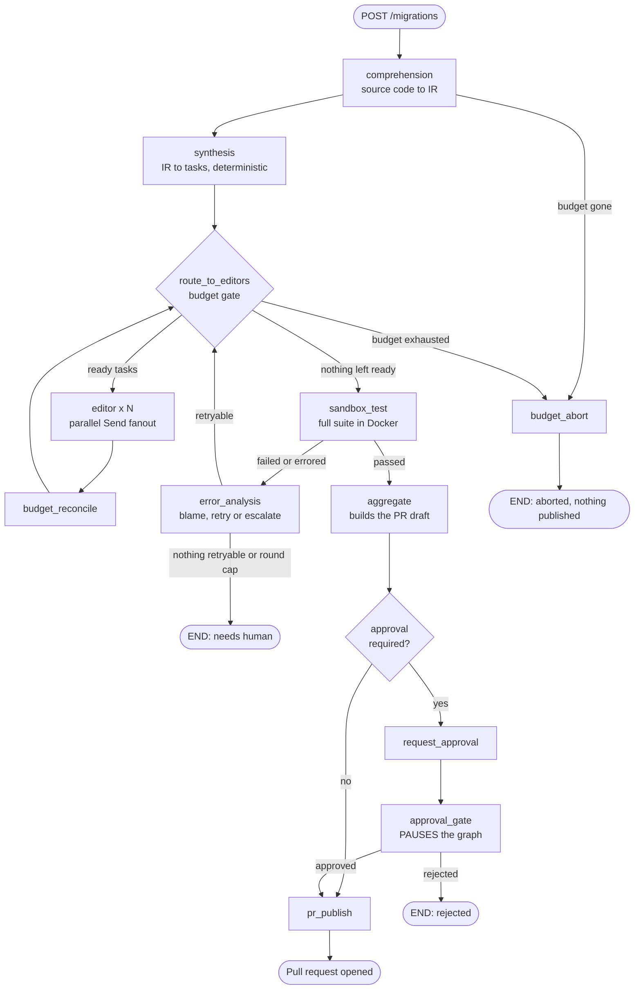
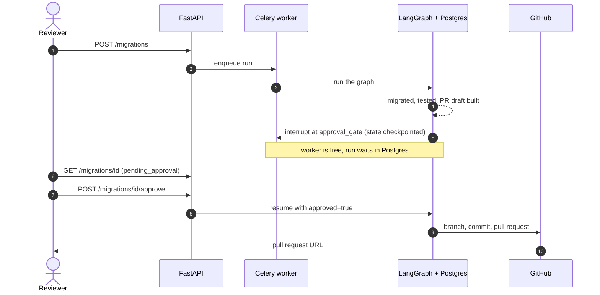

<a id="readme-top"></a>

<div align="center">

<h1>🔀 StackMigrate</h1>


<p>
An agentic system that reads a scoped module of a codebase, understands what it does,<br/>
and rewrites it in another stack — tested in a sandbox, budget-capped, and <b>never published without a human saying yes</b>.
</p>

<p>
  
  
  
  
</p>
<p>
  
  
  
  <a href="https://github.com/AdityaDabgotra/StackMigrate/actions/workflows/ci.yml"></a>
</p>
<p>
  
  
</p>


<br/><br/>

<b>
<a href="#-highlights">✨ Highlights</a> &nbsp;•&nbsp;
<a href="#-how-it-works">🧠 How it works</a> &nbsp;•&nbsp;
<a href="#-safety-model">🔒 Safety</a> &nbsp;•&nbsp;
<a href="#-quick-start">🚀 Quick start</a> &nbsp;•&nbsp;
<a href="#-api">🔌 API</a> &nbsp;•&nbsp;
<a href="#-configuration">🔧 Config</a> &nbsp;•&nbsp;
<a href="#-roadmap">🧭 Roadmap</a> &nbsp;•&nbsp;
<a href="#-status-and-known-gaps">🚧 Status</a>
</b>

</div>

<br/>

> [!NOTE]
> **Example.** Point it at a Spring Boot `@RestController` module. It reads the code, writes a framework-agnostic description of what the module does, generates FastAPI code for it in parallel, runs the tests in a locked-down Docker container, fixes what fails, and — only after a reviewer approves — opens a pull request.

---

## ✨ Highlights

<table>
<tr>
<td width="50%" valign="top">

### 🧬 Stack-agnostic by design
Comprehension reads source code and produces a plain-language **intermediate representation**. Synthesis reads *only* that IR, never the original code. Adding a stack means writing one adapter, not a pipeline per stack pair.

</td>
<td width="50%" valign="top">

### ⚡ Parallel, dependency-aware generation
Tasks fan out with LangGraph's `Send()`. A task runs once the tasks it depends on have succeeded, so a repository → service → router chain completes in waves, in a single run.

</td>
</tr>
<tr>
<td valign="top">

### 🔁 Self-correcting
A failed test run goes to an LLM error analyzer that names the guilty tasks and decides retry vs. escalate. Retries are bounded twice over: per task and per global round.

</td>
<td valign="top">

### 📦 Sandboxed execution
Generated code never runs on the host. Install and test run in separate containers: non-root, capabilities dropped, read-only root filesystem, resource-limited, and **network disabled** during tests.

</td>
</tr>
<tr>
<td valign="top">

### 💸 Budget guard
Three independent ceilings — **cost**, **LLM call count** and **wall clock** — enforced at one central gate. A run that can't afford its remaining work aborts cleanly instead of publishing a partial migration.

</td>
<td valign="top">

### 🙋 Human-in-the-loop approval
The graph truly *pauses* (a checkpointed LangGraph `interrupt()`) and resumes on a decision. The gate **fails closed**: only an explicit `approved: true` opens a PR.

</td>
</tr>
<tr>
<td valign="top">

### 🔭 Observable
One structured JSON log line per node (run id, duration, phase, cost, budget left). Optional LangSmith tracing, searchable by run.

</td>
<td valign="top">

### 🚢 Deployable
Docker image, `docker-compose` (Postgres + Redis + API + Celery worker), API-key auth, CI. Runs are durable: state lives in Postgres checkpoints.

</td>
</tr>
</table>

<p align="right"><a href="#readme-top">⬆ back to top</a></p>

---

## 🧠 How it works

Two phases that never share a code path:

| Phase | Reads | Produces |
|---|---|---|
| 🔍 **Comprehension** | Source code (any supported stack) | An `IntermediateRepresentation`: endpoints, services, data models, auth, business logic |
| 🛠️ **Synthesis** | **Only the IR** | Target-stack code, one task per target file |

### The pipeline



One router, `route_to_editors`, serves three edges (after synthesis, after each wave, after error analysis). That is why dependency waves and the retry loop are *the same mechanism*, not two.

### Life of an approval



<details>
<summary><b>📋 Run lifecycle: every phase a run can be in</b></summary>

<br/>

| Phase | Meaning |
|---|---|
| `comprehension` → `synthesis_planning` → `editing` → `testing` | The happy path through the pipeline |
| `error_analysis` | Sandbox failed; deciding what to retry |
| `aggregating` | Building the PR draft from the effective files |
| `awaiting_approval` | **Paused** — nothing published, waiting for a reviewer |
| `pr_generation` → `done` | Approved and published (or a dry run with no target repo) |
| `rejected` | A reviewer declined; terminal, nothing published |
| `aborted_budget` | A budget ceiling was hit; unfinished tasks marked `skipped` |
| `needs_human` / `failed` | Retries exhausted, or an unrecoverable error |

</details>

<p align="right"><a href="#readme-top">⬆ back to top</a></p>

---

## 🔒 Safety model

Generated code is untrusted input, and this system can open pull requests. Each risk has a specific control:

| Risk | Control |
|---|---|
| 💥 Running LLM-generated code | Docker sandbox: test container has **no network**, runs non-root, drops all capabilities, read-only rootfs, CPU/memory limits |
| 📂 Path traversal in generated files | Every diff path is untrusted: absolute paths, `..`, backslashes and odd characters are refused, and a batch with one bad path writes **nothing** |
| 🚫 Poisoned PRs | `.github/`, `.git/`, `.gitattributes` and `.gitmodules` are never publishable (a generated workflow could run with repository secrets) |
| 🐚 Shell injection | Install and test commands are argv lists, never shell strings |
| 💸 Runaway spend | Cost, call-count and wall-clock ceilings; parallel waves are sized by the largest call seen so far, so a wave can't overshoot by much |
| ✋ Unapproved PRs | The approval gate fails closed, **and** `pr_publish` independently refuses to publish if approval was required but not recorded |
| 🔑 Unauthenticated approvals | Every `/migrations` route needs an `X-API-Key`; the API refuses to boot without one unless explicitly opted out |
| 🔁 Double-click approvals | Per-run lock plus a re-check inside it: a concurrent double approve publishes once |

> [!WARNING]
> The worker needs the host's Docker socket to start sandbox containers, which is equivalent to root on that host. Don't run it on a shared machine. See [known gaps](#-status-and-known-gaps).

<p align="right"><a href="#readme-top">⬆ back to top</a></p>

---

## 🚀 Quick start

> [!IMPORTANT]
> The tests and the application code are verified. The **Docker image build, `docker compose up` and the CI workflow have not been run yet**, so expect to fix small things on first contact. See [status](#-status-and-known-gaps).

### 🐳 With Docker Compose

```bash
git clone https://github.com/AdityaDabgotra/StackMigrate.git
cd StackMigrate

cp .env.example .env     # then fill in the secrets (table below)
sudo mkdir -p /var/lib/stackmigrate/work   # or point STACKMIGRATE_WORK_DIR somewhere else

docker compose up --build
```

Compose refuses to start unless `ANTHROPIC_API_KEY`, `POSTGRES_PASSWORD` and `STACKMIGRATE_API_KEY` are set. Postgres and Redis publish no ports, and the API listens on `127.0.0.1:8000` only.

Generate an API key:

```bash
python -c "import secrets; print(secrets.token_urlsafe(32))"
```

### 🎬 Run a migration

```bash
export KEY=<your STACKMIGRATE_API_KEY>

# 1. submit
curl -X POST http://127.0.0.1:8000/migrations \
  -H "X-API-Key: $KEY" -H "content-type: application/json" \
  -d '{
        "source_repo_url": "https://github.com/org/spring-app.git",
        "source_stack": "springboot",
        "target_stack": "fastapi",
        "scope_description": "migrate the OrderController module only",
        "github_target_repo": "org/orders-api"
      }'
# -> 202 {"run_id": "..."}

# 2. watch it
curl -H "X-API-Key: $KEY" http://127.0.0.1:8000/migrations/<run_id>

# 3. when phase is "awaiting_approval", review `pending_approval`, then:
curl -X POST -H "X-API-Key: $KEY" http://127.0.0.1:8000/migrations/<run_id>/approve
#   or reject with a note:
curl -X POST -H "X-API-Key: $KEY" -H "content-type: application/json" \
  -d '{"feedback": "wrong module"}' http://127.0.0.1:8000/migrations/<run_id>/reject
```

### 🧑‍💻 Local development

<details>
<summary><b>Linux / macOS</b></summary>

```bash
python -m venv venv && source venv/bin/activate
pip install -r requirements-dev.txt
PYTHONPATH=. pytest tests/ -v
```

</details>

<details>
<summary><b>Windows (PowerShell)</b></summary>

```powershell
python -m venv venv
.\venv\Scripts\Activate.ps1
pip install -r requirements-dev.txt
$env:PYTHONPATH = "."
pytest tests/ -v
```

</details>

No API key, Docker daemon, GitHub token or Postgres is needed to run the suite: every external collaborator is faked. Lint with `ruff check app tests`.

<p align="right"><a href="#readme-top">⬆ back to top</a></p>

---

## 🔌 API

| Method | Path | Auth | What it does |
|---|---|:---:|---|
| `GET` | `/healthz` | – | Liveness probe |
| `POST` | `/migrations` | 🔑 | Submit a run → `202` with a `run_id` |
| `GET` | `/migrations/{run_id}` | 🔑 | Phase, tasks, budget, PR draft, `pending_approval`; `404` if the run never started |
| `POST` | `/migrations/{run_id}/approve` | 🔑 | Resume a paused run and publish. `409` if it isn't awaiting approval |
| `POST` | `/migrations/{run_id}/reject` | 🔑 | Resume a paused run as rejected (optional `{"feedback": "..."}`) |

Authentication is the `X-API-Key` header. Per-run limits can be set in the request body (`max_usd`, `max_llm_calls`, `max_wall_clock_seconds`); otherwise they come from the environment.

<details>
<summary><b>📄 What a paused run looks like (abridged)</b></summary>

```json
{
  "run_id": "…",
  "phase": "awaiting_approval",
  "approval_status": null,
  "budget_spent_usd": 0.09,
  "budget_max_usd": 5.0,
  "budget_llm_calls_made": 4,
  "pending_approval": {
    "title": "Migrate orders",
    "body": "…",
    "branch_name": "stackmigrate/…",
    "files": [
      "app/repositories/order_repository.py",
      "app/services/order_service.py",
      "app/routers/order.py"
    ]
  },
  "pr_url": null
}
```

After a decision, `pending_approval` is `null` and `approval_status` / `human_feedback` are filled in.

</details>

<p align="right"><a href="#readme-top">⬆ back to top</a></p>

---

## 🔧 Configuration

Copy `.env.example` to `.env`.

| Variable | Required | Default | Purpose |
|---|:---:|---|---|
| `ANTHROPIC_API_KEY` | ✅ | – | LLM access |
| `STACKMIGRATE_API_KEY` | ✅ | – | Shared secret for the `X-API-Key` header |
| `POSTGRES_PASSWORD` | ✅ (compose) | – | Creates the database and builds the container DB URL |
| `GITHUB_TOKEN` | to publish PRs | – | Used by the GitHub publisher |
| `MIGRATION_DB_URL` | local dev | `postgresql://…@localhost:5432/stackmigrate` | LangGraph checkpoint store |
| `REDIS_URL` | local dev | `redis://localhost:6379/0` | Celery broker and backend |
| `STACKMIGRATE_WORK_DIR` | – | `/tmp/stackmigrate-runs` | Where run checkouts live. With compose it must be the **same absolute path on the host and in the worker** |
| `DEFAULT_MAX_USD_PER_RUN` | – | `5.00` | Cost ceiling |
| `DEFAULT_MAX_LLM_CALLS_PER_RUN` | – | `500` | Call-count ceiling |
| `DEFAULT_MAX_WALL_CLOCK_SECONDS` | – | `3600` | Wall-clock ceiling |
| `COMPREHENSION_MODEL` / `EDITOR_MODEL` / `ERROR_ANALYSIS_MODEL` | – | `claude-sonnet-4-6` | Model per stage |
| `ANTHROPIC_INPUT_COST_PER_MTOK` / `ANTHROPIC_OUTPUT_COST_PER_MTOK` | – | `3.00` / `15.00` | Prices behind the budget guard — **keep them current**, or the ceiling is wrong |
| `LANGSMITH_TRACING` / `LANGSMITH_API_KEY` / `LANGSMITH_PROJECT` | – | `false` / – / `stackmigrate` | Optional tracing |
| `STACKMIGRATE_ALLOW_NO_AUTH` | – | – | `1` disables auth. **Local development only** |

<p align="right"><a href="#readme-top">⬆ back to top</a></p>

---

## 📁 Project structure

<details>
<summary><b>Click to expand the tree</b></summary>

```text
stackmigrate/
├── app/
│   ├── adapters/                 # plug points that keep the pipeline stack-agnostic
│   │   ├── base.py               #   SourceAdapter: discover and prompt-ify files for ONE stack
│   │   ├── springboot/           #   Spring Boot source adapter
│   │   ├── fastapi_target/       #   FastAPI target: test adapter + synthesis adapter
│   │   ├── target_test_base.py   #   how to install deps and run tests for a target stack
│   │   ├── target_synthesis_base.py  # where migrated code lives, per kind of unit
│   │   └── registry.py, target_registry.py
│   ├── api/                      # FastAPI app, API-key auth, schemas, task submitter
│   ├── core/                     # LLM clients, observability (logs + trace config)
│   ├── db/                       # Postgres checkpointer + state serializer allow-list
│   ├── graph/
│   │   ├── build.py              #   assembles the StateGraph
│   │   ├── routing.py            #   every conditional edge + budget and approval policy
│   │   ├── diffs.py              #   "effective" files: latest attempt per succeeded task
│   │   ├── nodes/                #   comprehension, synthesis, editor, budget_reconcile,
│   │   │                         #   sandbox_test, error_analysis, aggregate, approval,
│   │   │                         #   pr_publish, budget_abort
│   │   └── state/                #   Pydantic models + the GraphState TypedDict
│   ├── sandbox/                  # Docker runner, safe diff application
│   ├── services/                 # repo prep: git clone, or scaffold a target skeleton
│   ├── vcs/                      # GitHub publisher + publishable-path rules
│   ├── worker/                   # Celery app and the run task
│   └── main.py                   # production entrypoint (lifespan owns the DB pool)
├── tests/                        # 157 tests
├── Dockerfile, docker-compose.yml, .github/workflows/ci.yml
└── requirements.txt, requirements-dev.txt, ruff.toml, .env.example
```

</details>

---

## 🧪 Testing

**157 tests**, all passing, with every external collaborator replaced by a fake (LLM, Docker, GitHub, Postgres). The exception is `test_repo_prep.py`, which does a real, tiny `git clone`.

| What | Where |
|---|---|
| Every node in isolation | `test_*_node.py` |
| The **real compiled graph** end-to-end (real `Send()`, reducers, conditional edges) | `test_graph_integration.py` |
| Retry loop recovers; round cap terminates a run that never stops failing | `test_graph_integration.py` |
| Budget ceilings, wave capping, abort paths | `test_budget_guard.py` |
| Real `interrupt()` pause and resume, fail-closed gate, concurrent double-approve | `test_approval_flow.py` |
| Auth on every route; refuses to boot without a key | `test_api_auth.py` |
| Strict checkpoint round-trip; Celery registers the task | `test_deployment_wiring.py` |
| Path traversal, publishable paths, container security config | `test_sandbox_workspace.py`, `test_vcs_paths.py`, `test_docker_runner_kwargs.py` |

> [!TIP]
> Node-level tests can't catch wiring bugs. LangGraph silently drops any state key a node returns that isn't declared in `GraphState`, which is exactly how an undeclared `pr_draft` once vanished with no error. **Every key a node returns must be declared in the state.** Only the full-graph tests catch this class of bug.

Beyond the suite, the following were checked by hand against a real Postgres and Redis (without Docker): a run paused in one process and approved from another, with strict checkpoint deserialization; a real API and Celery worker as separate processes receiving a submitted job.

<p align="right"><a href="#readme-top">⬆ back to top</a></p>

---

## 🧭 Roadmap

| | Step | What it delivered |
|:-:|---|---|
| ✅ | **1 · Scaffolding** | Project layout, Pydantic state schema, reducers for parallel fanout, Postgres checkpointer |
| ✅ | **2 · Comprehension** | Adapter interface, Spring Boot adapter, scoped discovery, IR extraction with cost tracking |
| ✅ | **3 · Sandbox** | Docker runner, FastAPI test adapter, path-safe workspace application |
| ✅ | **4 · Synthesis + editors** | Deterministic task planning, parallel `Send()` fanout, budget deltas |
| ✅ | **5 · Retry loop** | LLM error analysis, multi-wave scheduling, two independent loop bounds |
| ✅ | **6 · PR generation** | Deterministic PR draft, path re-validation, GitHub publisher |
| ✅ | **7 · API layer** | FastAPI + Celery, repo prep, status read from checkpoints |
| ✅ | **8 · Budget guard + observability** | Three ceilings, central gate, abort node, JSON logs, LangSmith metadata |
| ✅ | **9 · Human approval** | Real `interrupt()` pause/resume, `approve` / `reject`, fail-closed gate |
| ✅ | **10 · Deployment** | Dockerfile, compose, CI, API-key auth, Celery and checkpoint-serializer fixes |

<p align="right"><a href="#readme-top">⬆ back to top</a></p>

---

## 🚧 Status and known gaps

> [!CAUTION]
> **This is a working prototype, not a hardened production service.** Everything below is stated plainly so nobody is surprised.

<table>
<tr>
<td width="50%" valign="top">

**✅ Verified**
- The full test suite (157)
- Real Postgres checkpoints, including a pause in one process and approval from another
- Real API + Celery worker as separate processes
- Auth, budget aborts, and the fail-closed approval gate under test

</td>
<td width="50%" valign="top">

**⚠️ Not yet verified**
- `docker build` and `docker compose up`
- The Docker-socket sandbox path *inside* the worker container
- The CI workflow (never run)
- A full run with live LLM calls and a real GitHub PR

</td>
</tr>
</table>

<details>
<summary><b>📋 Known gaps (12) — click to expand</b></summary>

<br/>

1. **A run that fails before the graph starts is invisible.** If repo prep fails (bad URL, no access) no checkpoint is written, so `GET /migrations/{id}` returns `404` forever instead of "failed".
2. **No editor file contract.** Nothing enforces that generated output is exactly the task's declared `target_files`, so an editor could add or rewrite undeclared files (including the target repo's own tests). It also means the sandbox's stale-file cleanup could delete a pre-existing target file an earlier attempt overwrote.
3. **Error-analysis feedback is not used.** `suggested_fix_instructions` is computed but never reaches the retry prompt, so a retry is a blind second attempt.
4. **Comprehension undercounts LLM calls.** It records N extraction calls as one, so `max_llm_calls` is looser than it looks.
5. **Nodes mutate `BudgetState` in place.** Safe today, risky for checkpoint history.
6. **Wall clock keeps running while a run waits for approval.** Dormant today, since a rejection terminates the run.
7. **API security is minimal.** One shared key: no per-user identity, rotation or rate limiting; no TLS (put a reverse proxy in front); no record of *who* approved a PR.
8. **The approval lock is in-process.** With several API replicas, two could both resume a run; serialize on the run in the database.
9. **Reviewers see the PR body and file paths, not file contents or a diff.**
10. **Reject is terminal.** No "request changes" loop that feeds `human_feedback` back to the editors; runs left waiting never expire.
11. **The worker holds the Docker socket** (root-equivalent on the host). Options: rootless Docker, a remote sandbox host, or a dedicated sandbox service.
12. **Dependencies are unpinned** (`>=` ranges). Generate a lock file (for example with `pip-compile`) before relying on reproducible builds.

</details>

<details>
<summary><b>🧱 Design decisions worth knowing</b></summary>

<br/>

**Why an intermediate representation?** Without it, N source stacks and M targets means N×M pipelines. With it, it is N readers and M writers, and synthesis can never accidentally copy source-framework idioms because it never sees the source.

**Why budget deltas instead of mutating the budget?** Under `Send()` fanout, state may be copied per branch, so an in-place update on one branch can be silently lost when another branch's result merges. Each editor branch appends its cost to an append-only list, and a single-writer `budget_reconcile` node folds in only the not-yet-consumed entries.

**Why does the retry loop reuse the dispatch router?** A task marked `RETRYING` is eligible for exactly the same dispatch path as a fresh, dependency-unblocked task. One mechanism, one set of bugs, and a full retry correctly re-establishes dependency order from scratch.

**Why is approval two nodes?** `interrupt()` doesn't commit the interrupting node's own state update, and on resume the node re-runs from its first line. So `request_approval` only records the phase, and `approval_gate` does nothing before `interrupt()` that must not happen twice.

**Why no separate "runs" database?** LangGraph's checkpoint store already *is* the durable, queryable record of every run. A second store would just be a second source of truth that could drift from the first.

**Why a `TypedDict` for `GraphState`?** LangGraph's merge machinery is built around `Annotated[T, reducer]` fields on a `TypedDict`. Each field still holds a Pydantic model, so validation happens where it matters.

**Why allow-list state types for checkpoints?** LangGraph is moving to block deserializing unregistered types. `state_serde()` registers every model and enum in `app.graph.state` (derived from `__all__`, so new ones are covered automatically), so a routine upgrade can't strand in-flight or paused runs.

</details>

<p align="right"><a href="#readme-top">⬆ back to top</a></p>

---

<div align="center">

**Built by [@AdityaDabgotra](https://github.com/AdityaDabgotra)**

If this project is useful or interesting to you, a ⭐ is appreciated.

</div>